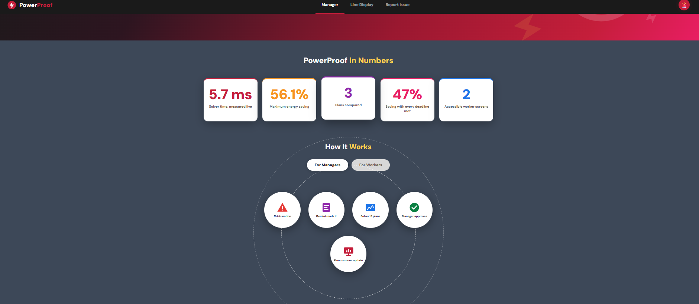
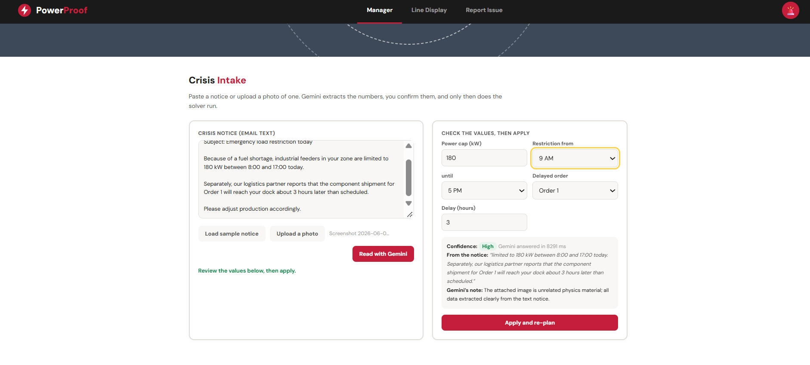
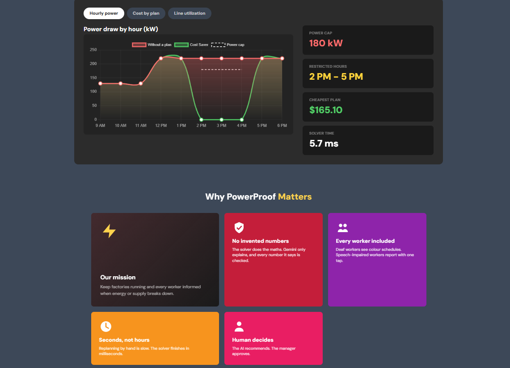
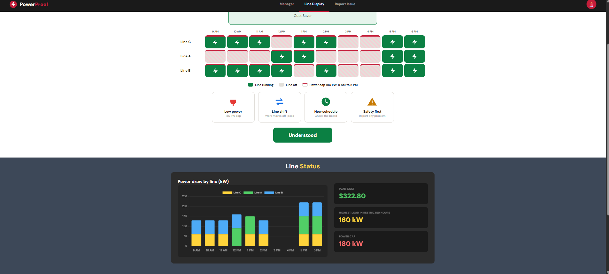
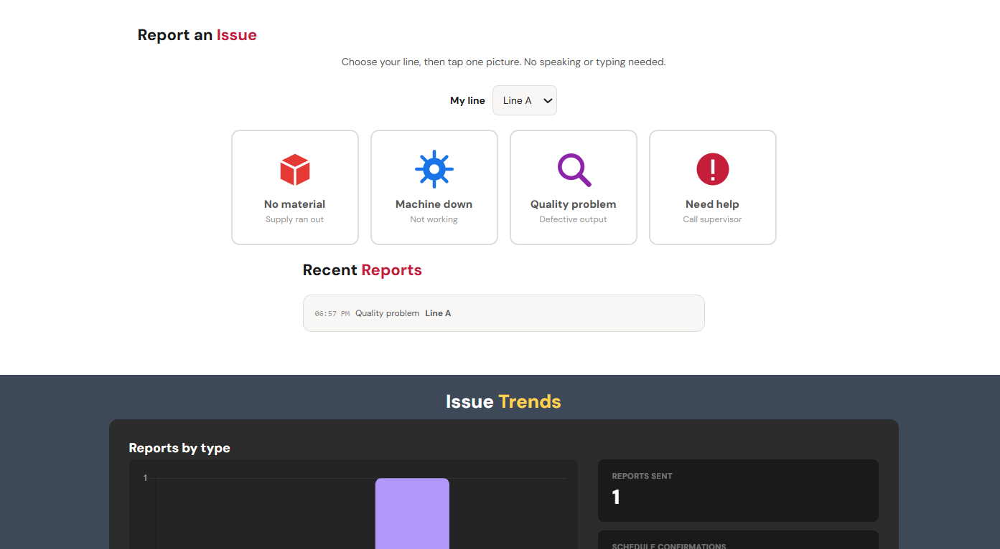

<div align="center">

# ⚡ PowerProof

### A crisis copilot for factories
The world is living through its worst energy disruption since the 1970s, with over 10 million barrels of oil per day removed from global supply, and factories across Bangladesh, India and Southeast Asia are shutting down or running partial shifts.<br>PowerProof turns a power or supply notice into three costed production plans, and the manager approves one that reaches every worker, including deaf and speech impaired colleagues.

<br>

🏆 **Google Cloud AI Builder Cup 2026**
Category: *Manufacturing: Intelligent Operations & Industrial Efficiency*

🌐 **Live demo:** `https://powerproof-144a1.web.app/` 

<br>



</div>

---

## ⚡ Tech Stack

<div align="center">
<table>
  <tr>
    <td align="center"><br><sub>HTML5</sub></td>
    <td align="center"><br><sub>CSS3</sub></td>
    <td align="center"><br><sub>JavaScript</sub></td>
    <td align="center"><br><sub>Node.js</sub></td>
    <td align="center"><br><sub>Python</sub></td>
  </tr>
  <tr>
    <td align="center"><br><sub>FastAPI</sub></td>
    <td align="center"><br><sub>Firebase</sub></td>
    <td align="center"><br><sub>Google Cloud</sub></td>
    <td align="center"><br><sub>Gemini</sub></td>
    <td align="center"><br><sub>OR-Tools</sub></td>
  </tr>
</table>
</div>

---

## ⚡ The problem

When energy or supply is cut mid shift, a manager has to decide fast which lines run in which hours, which orders slip and what it costs. Workers on the floor then have to be told. Spoken announcements do not reach deaf workers and speech-impaired workers cannot easily report a stopped machine. Most planning tools either give one rigid answer with no explanation or let a language model do arithmetic it is not reliable at.

---

## ⚡ What PowerProof does

| Step | What happens |
|---|---|
| 📩 **Crisis intake** | The manager pastes a notice (or uploads a photo of one). **Gemini** extracts the power cap, the restriction window and any material delay, with the exact words it relied on and a confidence level. |
| ✅ **Validation** | Extracted values go through deterministic checks (range, order and window). Anything implausible is dropped with a warning. The manager reviews and confirms before anything changes. |
| 📊 **Three plans** | A scheduling engine computes three genuinely different plans (see below). |
| 🔍 **Independent check** | A separate validator re-derives peak-cap compliance, material readiness, units produced, cost and deadline status from each schedule. |
| 💬 **Gemini explains** | For each plan Gemini writes a short explanation in English, Hindi or Bangla. Every number in its answer is checked against the solver's data. Unknown numbers are flagged on screen. |
| 👤 **Manager approves** | One tap. The AI never decides. |
| 🎨 **Floor screen (deaf workers)** | The approved schedule appears as a colour grid of hours per line, with the restricted window marked. No reading or hearing required. Workers tap *Understood*. |
| 🖐️ **Report panel (speech impaired workers)** | Four large picture buttons (no material, machine down, quality problem and need help) plus a line selector. One tap reaches the manager in real time. |

### ⚡ The three plans

| Plan | Goal |
|---|---|
| 💰 **Plan A, Cost Saver** | Cheapest schedule. Deadlines are relaxed, so an order may be flagged *at risk*. The risk is shown, never hidden. |
| ⏱️ **Plan B, Deadline Protector** | Every deadline met and lines finish as early as possible (higher cost). |
| ⚖️ **Plan C, Balanced** | The cheapest plan that still meets every deadline (the recommendation). |

---

## ⚡ Screenshots

<div align="center">

### Manager view: crisis intake



<br><br>

### Manager view: plans and numbers



<br><br>

<table>
  <tr>
    <td align="center" width="50%">
      <b>Floor screen for deaf workers</b><br><br>
      
    </td>
    <td align="center" width="50%">
      <b>Report panel for speech-impaired workers</b><br><br>
      
    </td>
  </tr>
</table>

</div>

---

## ⚡ Where Gemini is used, and where it is deliberately not

| Job | Who does it |
|---|---|
| Read a messy notice or a photo of one | 🤖 **Gemini** (multimodal, JSON output) |
| Check the extracted numbers | 🧮 deterministic code (`guards.js`) |
| Compute schedules, costs and deadlines | 🧮 scheduling engine (`solver.js`), never Gemini |
| Verify the schedules | 🧮 independent validator |
| Explain plans and answer "why?" in 3 languages | 🤖 **Gemini**, constrained to the solver's data |
| Verify the explanation's numbers | 🧮 deterministic code |
| Decide | 👤 the manager |

---

## ⚡ Architecture

```
 Browser (Firebase Hosting, static)
 ├─ solver.js   exact scheduling search + independent validator   (no network)
 ├─ gemini.js ──► Firebase AI Logic ──► Gemini Developer API       (App Check enforced)
 ├─ guards.js   extraction sanitiser + number verifier             (no network)
 └─ sync.js   ──► Cloud Firestore   pp_state/current, pp_events    (real-time across devices)
```

There is no server to run and no API key in this repository. Firebase AI Logic holds the Gemini credentials. The browser proves it is the real app with **Firebase App Check** (reCAPTCHA Enterprise). Everything runs on the free Spark plan.

### ⚡ The scheduling engine

`firebase-hosting/public/js/solver.js` is a JavaScript port of the CP-SAT model in `backend/solver.py`. The search is exact: each line chooses the hours it runs, the peak hour power cap couples the lines and a branch and bound search finds the optimum for each plan's objective. It cannot run OR-Tools in the browser, so the port is **tested against the real OR-Tools model**.
---

## ⚡ Data (simulated)

There is no public dataset that combines tariffs, machine capacity and order deadlines for a factory, so the demo uses a **simulated** factory. It is labelled as such in the interface.

| Parameter | Value |
|---|---|
| 🏗️ Lines | Line A 90 kW / 120 units per h<br>Line B 70 kW / 95<br>Line C 60 kW / 80 |
| 📦 Orders | Order 1: 480 units, due slot 7<br>Order 2: 650 units, due slot 9<br>Order 3: 500 units, due slot 9 |
| 🕘 Day | 10 one hour slots, 09:00 to 19:00 |
| 💲 Tariff | $0.13 per kWh off peak<br>$0.32 per kWh in the restricted window<br>(illustrative, not taken from a utility) |
| 🚨 Default crisis | 180 kW cap from 14:00 to 17:00<br>Order 1 material 3 hours late |

All of these can be changed in the Crisis Intake form or in `solver.js`. The engine is not fitted to one scenario.

---

## ⚡ Tests (what is actually verified)

```bash
cd firebase-hosting
npm install
npm run test:all
```

| Test | What it proves |
|---|---|
| `solver.test.mjs` | Costs of Plan A and Plan C match the **real OR-Tools CP-SAT** model on 35 scenarios (fixtures generated by `backend/export_test_cases.py`). Across 400 random scenarios every feasible plan passes the validator and A ≤ C ≤ B in cost. A tampered plan is rejected. Impossible caps give "no feasible plan", not a crash. |
| `guards.test.mjs` | Invented numbers are caught (including Bangla and Hindi digits). Out-of-range extractions are rejected. |
| `i18n.test.mjs` | Every UI string exists in English, Hindi and Bangla with matching placeholders. |
| `dom.smoke.mjs` | The full manager, floor screen, worker report, language and reset flow runs in a simulated browser. |
| `dom.gemini.test.mjs` | The Gemini path (extract, confirm, re plan, explain and verify) with a fake model that deliberately invents a number, which is flagged. |

---

## ⚡ Security and data handling

- No credentials in the repository. `firebase-config.js` holds public identifiers only.
- Gemini is reachable only through Firebase AI Logic with App Check enforced.
- Firestore rules (`firestore.rules`) allow only two collections, shape check writes and make events append only. There is no sign-in, so they are demo grade. Do not store anything sensitive.

---

## ⚡ Team

**Noor-E Arafin Rafi** (Team Leader), **Tahsin Shuborna**: Team **Ra.One**

